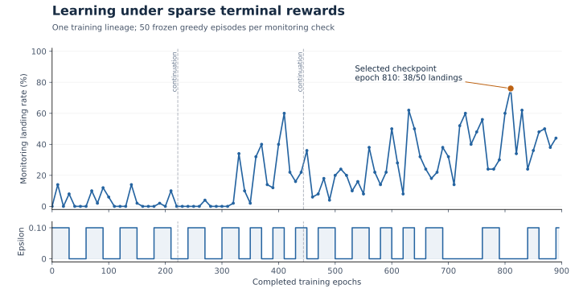

# Error-Defined Neural Q-Learning for Sparse Terminal Rewards

Jaeyoung Oh

Error-Defined Neural Q-Learning represents a state-action value through the
logarithmic ratio of initial and learned random-network prediction errors.
The neural predictor learns directly from Bellman targets. This repository
provides the PyTorch implementation, experiment configurations, a trained
checkpoint, and evaluation records for **LunarLander-v3 with terminal-only
landing and crash rewards**.

A checkpoint selected using a separate monitoring set achieved **422 landings
in 500 held-out greedy evaluation episodes (84.4%)**. Evaluation used five
environment RNG streams, with 100 successive episodes per stream and fixed
network weights. Training used one environment, continuous observation inputs,
and no dense reward shaping.

[Evaluate the checkpoint](#evaluate-the-checkpoint) ·
[Train from scratch](#train-from-scratch) ·
[Method and protocol](docs/method.md) ·
[Recorded results](results/holdout.json)

## Method

For a state-action input $x$, let $f$ be a frozen random network,
$g_\theta$ the trainable predictor, and $g_0$ a frozen copy of the predictor
at initialization. Each network produces $d=128$ features:

$$
\begin{aligned}
e_0(x) &= \frac{1}{d}\left\lVert g_0(x)-f(x)\right\rVert_2^2, \\
e_\theta(x) &= \frac{1}{d}\left\lVert g_\theta(x)-f(x)\right\rVert_2^2.
\end{aligned}
$$

The error-defined action value is

$$
Q_\theta(x)=c\log_{10}\left(
\frac{e_0(x)+\eta}{e_\theta(x)+\eta}
\right),
\qquad c=100,\quad\eta=10^{-8}.
$$

The same definition in plain text, with `g` the trainable predictor, `g0` its
frozen initial copy, and `mean` taken over the output features:

```text
initial_error(x) = mean((g0(x) - f(x))**2)
current_error(x) = mean((g(x) - f(x))**2)
Q(x) = 100 * log10((initial_error(x) + 1e-8) / (current_error(x) + 1e-8))
```

This definition gives exactly zero Q-values at initialization. Error below the
initial reference produces positive Q; error above it produces negative Q.
A separate lagged predictor supplies detached Q-learning targets. Adam trains
the live predictor on squared TD error, so the learning signal can move its
prediction error in either direction. There is no auxiliary distillation loss
or intrinsic reward.

The method takes inspiration from **random network distillation (RND)** and
examines prediction error as a value representation for **deep reinforcement
learning with sparse rewards**. A frozen reference remains available throughout
training, although shared network weights can still change values at inputs
that have not been trained directly.

Learning rewards are **0 at nonterminal steps, +100 on native landing, and -100
on native crash**. Episodes are capped at 1,000 steps, and whole timeout
trajectories are excluded from training. Timeouts count in all evaluation
denominators. Elapsed time is an input; there is no time penalty. See the
[method](docs/method.md) for replay order, target updates, and exploration.

## Results

The selected checkpoint is epoch 810, after **52,223,579 training interactions**
and **539,297 optimizer updates**. Selection used frozen greedy monitoring on
50 separate seeds. The checkpoint was fixed before the following holdout began.

| Held-out environment seed | Episodes | Landings | Crashes | Timeouts | Mean raw return |
| --- | ---: | ---: | ---: | ---: | ---: |
| 3,000,001 | 100 | 84 | 5 | 11 | 117.43 |
| 3,000,002 | 100 | 79 | 6 | 15 | 60.28 |
| 3,000,003 | 100 | 86 | 1 | 13 | 136.96 |
| 3,000,004 | 100 | 88 | 1 | 11 | 180.68 |
| 3,000,005 | 100 | 85 | 2 | 13 | 165.67 |
| **Total** | **500** | **422 (84.4%)** | **15** | **63** | **132.20** |

Each stream seeds a new environment once, then uses 99 further unseeded resets.
These are **five evaluation seeds for one trained model**, not independent
training replications. Raw return includes Gymnasium's shaping and engine costs;
it is recorded only for reporting. Its mean of 132.20 is below the conventional
200-point mean-return criterion.



Performance varied during training. On the earlier 100-episode evaluation bank,
the selected checkpoint achieved **88/100 landings**, while the final checkpoint
achieved **36/100**. The holdout result establishes landing performance of the
selected policy; it does not establish sustained convergence or reliability
across independent training runs.

All holdout episodes, earlier evaluation banks, epoch metrics, monitoring
scores, and continuation settings are available under [results/](results/).
The [artifact manifest](results/artifact_manifest.json) records their checksums.

## Installation

Use Python 3.9 through 3.12. The recorded experiment used Python 3.9.6 on macOS
with CPU execution. Runtime dependencies are pinned in [pyproject.toml](pyproject.toml).

```bash
git clone https://github.com/BlueJayXRStudio/error-defined-neural-q-learning.git
cd error-defined-neural-q-learning
python3 -m venv .venv
source .venv/bin/activate
python -m pip install --upgrade pip setuptools wheel
python -m pip install swig
python -m pip install -e .
```

Box2D may require a C++ compiler when a compatible wheel is unavailable.
On macOS, install the Command Line Tools with `xcode-select --install` if needed;
on Debian or Ubuntu, install `build-essential` and `python3-dev`.
On Windows, activate the environment with `.venv\Scripts\Activate.ps1`.
See Gymnasium's [Box2D installation guidance](https://gymnasium.farama.org/environments/box2d/).

## Evaluate the checkpoint

The trained checkpoint is included in the repository. Reproduce the five
100-episode holdout streams with frozen weights and greedy actions:

```bash
ednq-evaluate --checkpoint checkpoints/epoch_000810.pt \
  --seeds 3000001 3000002 3000003 3000004 3000005 \
  --episodes 100 --output evaluation_holdout.json
```

For an interactive view of the same fixed policy:

```bash
ednq-evaluate --checkpoint checkpoints/epoch_000810.pt \
  --seeds 4000001 --render --episodes 0
```

Close the window or press Escape to stop viewing. Evaluation performs no
learning and does not reload weights. Numerical and physics-library differences
across platforms can affect trajectories.

## Train from scratch

Inspect the first segment's configuration, then run it in a new output folder:

```bash
ednq-train --config configs/segment_1.json --dry-run
ednq-train --config configs/segment_1.json --execute --output runs/segment_1
```

To repeat the complete **40 + 40 + 80 minute** training protocol, select the best
completed monitor from the last segment, and run its 500-episode evaluation:

```bash
python reproduce.py --output runs/reproduction
```

The first segment starts fresh. The two continuations preserve networks, Adam,
and the exploration controller, while restarting replay and random streams with
the recorded seeds. This is checkpoint continuation, not exact resume. Epsilon
switches automatically between 0.10 and 0 using a separate monitoring set.
Each completed epoch is saved.

These commands reproduce the procedure. Wall-clock limits make interaction
counts and continuation boundaries machine-dependent, so a new run need not
recreate the included checkpoint. The [protocol](docs/method.md#training-and-evaluation-protocol)
and [recorded lineage](results/training_lineage.json) give the full settings.

## Related work

Random Network Distillation uses prediction error as an exploration bonus
([Burda et al., 2018](https://arxiv.org/abs/1810.12894)). Here the logarithmic
error ratio defines Q itself. Replay and separate target networks are established
components of deep Q-learning
([Mnih et al., 2015](https://doi.org/10.1038/nature14236)); backward replay has a
direct precedent in [Lin, 1992, Section 2.3](https://link.springer.com/content/pdf/10.1007/BF00992699.pdf#page=7).

Related representations include
[free-energy Q-values](https://proceedings.neurips.cc/paper/2000/hash/2d1b2a5ff364606ff041650887723470-Abstract.html),
[RND penalties in offline SAC](https://proceedings.mlr.press/v202/nikulin23a.html),
and [TD-trained random-network prediction errors for value uncertainty](https://arxiv.org/abs/2505.21119).
The formulation studied here combines a frozen initial reference, a signed
logarithmic error ratio, and direct Bellman regression on terminal learning
rewards. These connections and the current experiments do not establish a
worldwide priority claim or isolate which component explains the observed result.

## Citation and license

Citation metadata is provided in [CITATION.cff](CITATION.cff). Code is released
under the [MIT License](LICENSE). The environment is provided by
[Gymnasium, maintained by the Farama Foundation](https://gymnasium.farama.org/).

The bundled measurements were collected before standalone packaging. The
checkpoint and numeric episode records are preserved; files are organized for
reproduction. Independent training seeds, matched conventional Q-network
comparisons, and evaluation on additional environments remain future work.
